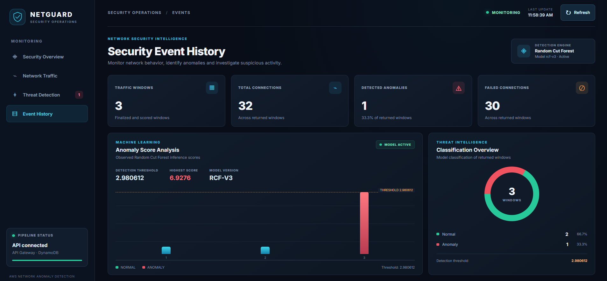
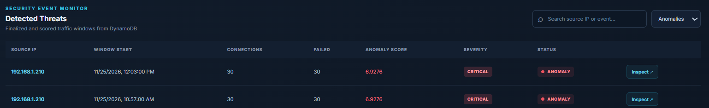
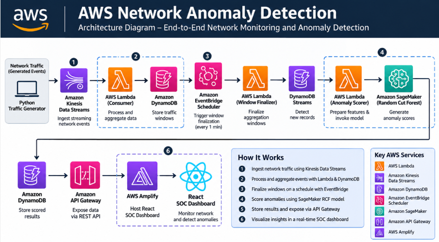
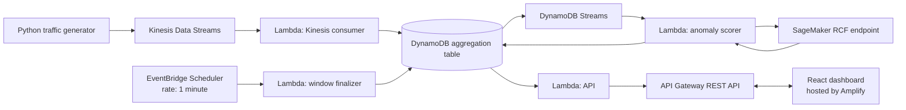

# AWS Network Anomaly Detection

A cloud-native network traffic monitoring and anomaly detection platform
built with AWS managed services, Python, and a React SOC-style
dashboard.

The system ingests generated network events, aggregates them into time
windows, scores finalized windows with an Amazon SageMaker Random Cut
Forest (RCF) model, and exposes the results through a REST API for
dashboard visualization.

> **Project status:** End-to-end ingestion, aggregation, scheduled
> finalization, SageMaker inference, API retrieval, and dashboard
> deployment have been implemented and tested. This repository documents
> the current implementation, not a production-certified intrusion
> detection system.

## Dashboard and architecture

### SOC dashboard




### Detected threats



### Event details


### AWS architecture



### Port scan test


## 1. Project objectives

-   Ingest network traffic events through a streaming service.
-   Process events with serverless compute.
-   Aggregate network activity into time-based windows.
-   Apply unsupervised machine learning to identify unusual traffic
    patterns.
-   Store scored results and expose them through an API.
-   Visualize network activity and anomaly classifications in a web
    dashboard.
-   Demonstrate practical skills across networking, AWS, serverless
    architecture, data engineering, and cloud security.

## 2. Architecture at a glance



**Processing sequence:**

1.  A Python traffic generator publishes events to Amazon Kinesis Data
    Streams.
2.  The Kinesis consumer Lambda processes events and updates time-window
    aggregation records in DynamoDB.
3.  EventBridge Scheduler invokes the window-finalizer Lambda once per
    minute.
4.  The finalizer marks eligible windows as `FINALIZED`.
5.  DynamoDB Streams invokes the anomaly-scorer Lambda for relevant
    record changes.
6.  The scorer transforms the aggregation metrics into the model's
    10-feature input and invokes the SageMaker RCF endpoint.
7.  The scorer compares the returned score with the configured threshold
    and writes the score, classification, and model version to DynamoDB.
8.  The API Lambda reads finalized records from DynamoDB and returns
    JSON through API Gateway.
9.  The React dashboard, hosted by AWS Amplify, calls the API and
    displays the returned data.

See [EXPLANATION.md](EXPLANATION.md) for component responsibilities and
the data lifecycle, and [DEPLOYMENT.md](DEPLOYMENT.md) for deployment
notes.

## 3. AWS services and responsibilities

  -----------------------------------------------------------------------
  Layer                   Service / component     Responsibility
  ----------------------- ----------------------- -----------------------
  Event source            Python traffic          Creates normal and
                          generator               simulated suspicious
                                                  network events

  Ingestion               Amazon Kinesis Data     Receives streaming
                          Streams                 events

  Stream processing       AWS Lambda - Kinesis    Decodes, validates,
                          consumer                deduplicates, and
                                                  aggregates events

  Aggregation store       Amazon DynamoDB         Stores traffic windows
                                                  and processing metadata

  Scheduling              Amazon EventBridge      Triggers periodic
                          Scheduler               window finalization

  Window management       AWS Lambda - window     Finalizes eligible
                          finalizer               aggregation windows

  Change notification     DynamoDB Streams        Announces changes to
                                                  DynamoDB records

  Inference orchestration AWS Lambda - anomaly    Builds model features,
                          scorer                  invokes SageMaker, and
                                                  classifies scores

  ML inference            Amazon SageMaker Random Produces anomaly scores
                          Cut Forest              

  API                     AWS Lambda - API and    Retrieves and exposes
                          Amazon API Gateway      scored records

  Frontend hosting        AWS Amplify             Hosts the React
                                                  application

  Frontend                React and Vite          Displays traffic and
                                                  detection results
  -----------------------------------------------------------------------

## 4. Main implementation details

### Network event ingestion

The Python traffic generator publishes event records to:

-   **Kinesis stream:** `network-traffic-stream-v3`
-   **AWS Region:** `ap-southeast-1`
-   **Capacity mode:** On-demand
-   **Retention:** 24 hours
-   **Configured shards:** 4

The generated events include network attributes such as source and
destination IP addresses, destination port, protocol, connection
outcome, byte counts, timestamp, and a unique event identifier.

### Aggregation and idempotency

The Kinesis consumer aggregates traffic into time-based windows in:

-   **DynamoDB table:** `network-anomaly-aggregation-v3`
-   **GSI:** `GSI1-OpenWindowsByFinalizeAt`

The aggregation includes total connections, unique destination IPs and
ports, TCP/UDP counts, failed connections, and bytes sent/received.

The consumer uses event identifiers and deduplication records to prevent
replayed events from being counted more than once. The table uses
on-demand billing, TTL for eligible records, and deletion protection.

### Scheduled finalization

EventBridge Scheduler invokes `network-anomaly-window-finalizer` on a
one-minute schedule. The finalizer queries eligible open windows using
the GSI, marks expired windows as `FINALIZED`, and removes the temporary
GSI attributes used to track open windows.

### Machine learning

The project uses the built-in Amazon SageMaker Random Cut Forest
algorithm for unsupervised anomaly scoring.

  Setting                    Implemented value
  -------------------------- ----------------------------------------------
  Model version label        `rcf-v3`
  Feature dimension          10
  Number of trees            100
  Samples per tree           256
  Training instance          `ml.m5.large`
  Inference endpoint         `network-anomaly-rcf-v3-serverless-endpoint`
  Serverless memory          2048 MB
  Maximum concurrency        1
  Classification threshold   `2.980612`

The scorer uses the same feature order and transformation logic as the
model's training data:

1.  `total_connections`
2.  `unique_destination_ips`
3.  `unique_destination_ports`
4.  `log_bytes_sent`
5.  `log_bytes_received`
6.  `failed_connection_rate`
7.  `destination_ip_ratio`
8.  `destination_port_ratio`
9.  `udp_ratio`
10. `log_failed_connections`

The scorer labels a record `ANOMALY` when its score is greater than
`2.980612`; otherwise it labels it `NORMAL`. This threshold is the
configured decision boundary for this project, not a universal RCF
threshold.

### API and dashboard

The API is exposed through API Gateway:

-   **Method:** `GET`
-   **Resource:** `/network-traffic`
-   **Stage:** `prod`
-   **Region:** `ap-southeast-1`

Example request:

``` text
https://cyym8ywtvj.execute-api.ap-southeast-1.amazonaws.com/prod/network-traffic?limit=100
```

The API supports a record limit and source-IP filtering. The current
global retrieval implementation uses a bounded DynamoDB Scan with
filtering and may return fewer records than the requested limit. It is
suitable for this portfolio-scale implementation; a production-scale
system should use purpose-built query indexes and pagination.

The frontend is a React/Vite application hosted by AWS Amplify. It calls
the API using the build-time `VITE_API_URL` environment variable. The
browser frontend does not access DynamoDB or SageMaker directly.

## 5. Validation results

The end-to-end pipeline was tested with normal traffic and a simulated
port scan.

### Normal traffic sample

  Attribute           Observed value
  ---------------- -----------------
  Source IP          `192.168.1.250`
  Anomaly score       `0.7437485975`
  Threshold               `2.980612`
  Classification            `NORMAL`

### Simulated port scan sample

The test generated 30 TCP events from `192.168.1.210` to `10.0.5.10`,
covering 30 unique destination ports with failed connections.

  Attribute                     Observed value
  -------------------------- -----------------
  Source IP                    `192.168.1.210`
  Destination IP                   `10.0.5.10`
  Total connections                         30
  Unique destination ports                  30
  Failed connections                        30
  Anomaly score                 `6.9276060125`
  Threshold                         `2.980612`
  Classification                     `ANOMALY`

These are observed results from the project's test events. They
demonstrate that the configured pipeline distinguished these two test
cases; they should not be interpreted as proof of detection accuracy
across all real-world network traffic.

Additional checks included Kinesis processing, duplicate-event handling,
DynamoDB aggregation, scheduled finalization, SageMaker endpoint
invocation, DynamoDB Streams processing, API HTTP 200 response, frontend
API integration, frontend production build, and GitHub push.

## 6. Repository structure

``` text
AWS-Network-Anomaly-Detection/
├── frontend/                 # React + Vite dashboard
├── lambda/                   # Lambda function source code
├── traffic-generator/        # Traffic event generators and test publishers
├── model-artifacts/          # Local model-related artifacts / test outputs
├── screenshots/              # Project screenshots used by this README
├── README.md
├── DEPLOYMENT.md
├── EXPLANATION.md
└── .gitignore
```

The exact contents may evolve as the project is extended. Do not commit
virtual environments, `node_modules`, build output, credentials, private
keys, or local environment files.

## 7. Security considerations

-   Use separate IAM roles for individual Lambda functions and grant
    only the permissions each function needs.
-   Do not commit AWS access keys, secret keys, session tokens, `.env`
    files, or local credential files.
-   Keep frontend configuration limited to non-secret values. A Vite
    variable such as `VITE_API_URL` is embedded in browser code and must
    never contain a secret.
-   The current API endpoint has no user authentication. Add an
    appropriate authorizer and access controls before exposing sensitive
    or production data.
-   Review CORS settings and restrict allowed origins to the deployed
    frontend where practical.
-   Protect logs and screenshots from exposing sensitive network
    information.
-   Review DynamoDB deletion protection and backup requirements before
    changing data-retention settings.

## 8. Cost considerations

The implementation uses managed and serverless services, but AWS
resources can continue to incur charges while deployed.

Cost-conscious settings include Kinesis on-demand mode, DynamoDB
on-demand billing, Lambda-based processing, and SageMaker Serverless
Inference with no provisioned concurrency. Training jobs, endpoint
invocations, data transfer, logs, storage, and other resources may still
incur charges.

Check AWS Billing and Cost Management regularly. Do not assume that an
idle project is completely free. When finished experimenting, follow a
deliberate resource shutdown plan and preserve any artifacts needed for
the portfolio.

## 9. Limitations and future improvements

Potential next improvements:

1.  Add API authentication and authorization.
2.  Add pagination and query-optimized DynamoDB indexes for larger
    datasets.
3.  Add operational alarms and dashboards in Amazon CloudWatch.
4.  Add notification workflows for high-priority detections.
5.  Add a real-time dashboard update mechanism.
6.  Expand testing with more representative normal and suspicious
    traffic.
7.  Establish a repeatable model evaluation and retraining process.
8.  Add infrastructure as code for reproducible deployment.
9.  Add automated tests and CI/CD checks.
10. Extend dashboard navigation and investigation workflows.

## 10. Technology stack

**Languages and frontend:** Python, JavaScript, React, Vite, CSS\
**AWS:** Amazon Kinesis Data Streams, AWS Lambda, Amazon DynamoDB,
Amazon EventBridge Scheduler, Amazon SageMaker, Amazon API Gateway, AWS
Amplify, AWS IAM, Amazon CloudWatch\
**Version control:** Git and GitHub

## 11. Repository

[GitHub - AWS Network Anomaly
Detection](https://github.com/bryanwork6099/AWS-Network-Anomaly-Detection)
