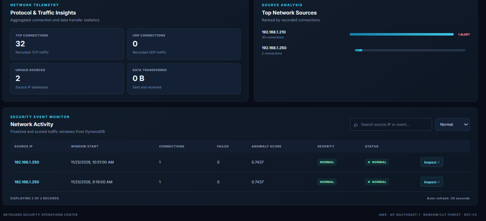
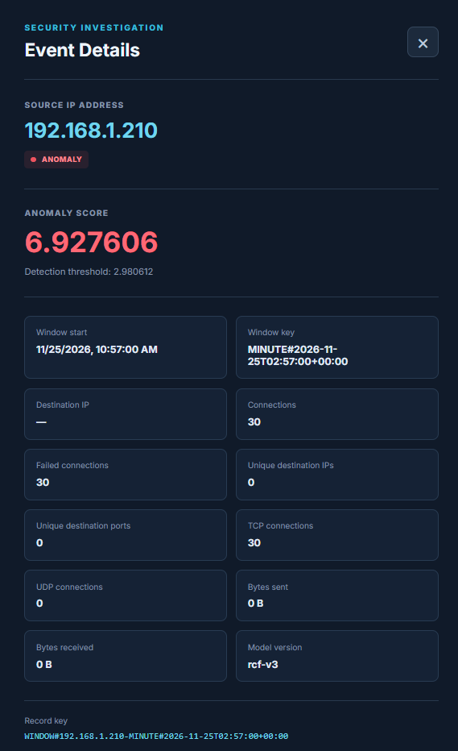
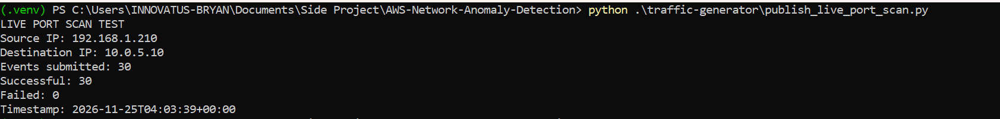
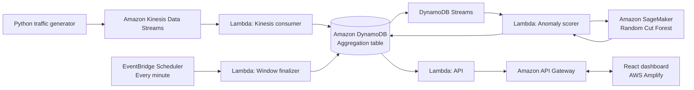

<div align="center">

# AWS Network Anomaly Detection

**A cloud-native network monitoring and machine-learning anomaly detection platform built on AWS.**

[](https://aws.amazon.com/)
[](https://www.python.org/)
[](https://react.dev/)
[](https://vite.dev/)
[](https://aws.amazon.com/about-aws/global-infrastructure/)

[Architecture](#architecture) · [Screenshots](#screenshots) · [How it works](#how-it-works) · [Validation](#validation-results) · [Documentation](#project-documentation)

</div>

---

## Overview

AWS Network Anomaly Detection is an end-to-end cloud project that ingests generated network events, aggregates activity into time windows, and uses **Amazon SageMaker Random Cut Forest (RCF)** to score potentially unusual traffic patterns.

The scored results are stored in Amazon DynamoDB and exposed through an API Gateway REST API. A React-based Security Operations Center (SOC)-style dashboard, hosted on AWS Amplify, presents traffic metrics and anomaly classifications.

> **Project scope:** This is a portfolio-scale implementation tested with generated traffic. It demonstrates an end-to-end anomaly-scoring workflow; it is not a production-certified intrusion detection system and does not automatically block network traffic.

### Project highlights

- Streaming event ingestion with Amazon Kinesis Data Streams.
- Serverless processing and time-window aggregation with AWS Lambda and DynamoDB.
- Scheduled window finalization using Amazon EventBridge Scheduler.
- Unsupervised anomaly scoring with Amazon SageMaker Random Cut Forest.
- REST API integration using Amazon API Gateway and Lambda.
- React SOC-style dashboard deployed through AWS Amplify.
- Normal-traffic and simulated port-scan test scenarios.

## Screenshots

### SOC dashboard

<div align="center">


*Dashboard overview*



*Additional dashboard view*

</div>

### Detection and investigation

| Detected threats | Event details |
|---|---|
|  |  |

### Live test



*CLI output from the simulated port-scan traffic test.*

## Architecture


### End-to-end data flow



### AWS services

| Layer | Service | Responsibility |
|---|---|---|
| Event generation | Python traffic generator | Produces normal and simulated suspicious network events |
| Ingestion | Amazon Kinesis Data Streams | Receives streaming traffic events |
| Stream processing | AWS Lambda — Kinesis consumer | Decodes, validates, deduplicates, and aggregates events |
| Data store | Amazon DynamoDB | Stores traffic windows and processing metadata |
| Scheduling | Amazon EventBridge Scheduler | Triggers periodic window finalization |
| Window management | AWS Lambda — window finalizer | Finalizes eligible aggregation windows |
| Change notification | DynamoDB Streams | Publishes changes to DynamoDB records |
| Inference orchestration | AWS Lambda — anomaly scorer | Builds model features, invokes SageMaker, and classifies scores |
| Machine learning | Amazon SageMaker Random Cut Forest | Produces anomaly scores |
| API | AWS Lambda and Amazon API Gateway | Retrieves and exposes scored records |
| Frontend hosting | AWS Amplify | Hosts the React application |
| User interface | React and Vite | Displays traffic and detection results |

## How it works

1. **Generate events.** A Python traffic generator creates network events containing source and destination IPs, destination port, protocol, connection outcome, byte counts, timestamp, and a unique event ID.
2. **Ingest the stream.** Amazon Kinesis Data Streams receives the generated records.
3. **Process and aggregate.** The Kinesis consumer Lambda processes records and updates time-window aggregation items in DynamoDB. Event IDs and deduplication records help prevent replayed events from being counted more than once.
4. **Finalize windows.** EventBridge Scheduler invokes the window-finalizer Lambda every minute. The finalizer identifies eligible windows, marks them `FINALIZED`, and removes temporary open-window index attributes.
5. **Trigger inference.** DynamoDB Streams delivers relevant record changes to the anomaly-scorer Lambda.
6. **Calculate an anomaly score.** The scorer transforms the aggregation into the model's 10-feature input and invokes the SageMaker endpoint.
7. **Classify and store.** The scorer compares the returned score with the configured threshold and writes the score, classification, and model version to DynamoDB.
8. **Serve results.** The API Lambda retrieves finalized records and returns JSON through API Gateway.
9. **Visualize.** The React dashboard, hosted by AWS Amplify, calls the API and displays the returned data.

For a deeper component-by-component explanation, see [EXPLANATION.md](EXPLANATION.md).

## Implementation details

### Traffic ingestion and aggregation

**Kinesis stream:** `network-traffic-stream-v3`

| Setting | Value |
|---|---|
| AWS Region | `ap-southeast-1` |
| Capacity mode | On-demand |
| Retention period | 24 hours |
| Configured shards | 4 |

**DynamoDB table:** `network-anomaly-aggregation-v3`

The consumer aggregates:
- Total connections.
- Unique destination IP addresses and destination ports.
- TCP and UDP connection counts.
- Failed connection counts.
- Bytes sent and received.

The table uses the `GSI1-OpenWindowsByFinalizeAt` index to locate open windows that are ready for finalization. It is configured with on-demand billing, TTL for eligible records, and deletion protection.

### Machine-learning model

The project uses the built-in Amazon SageMaker **Random Cut Forest** algorithm for unsupervised anomaly scoring.

| Parameter | Implemented configuration |
|---|---|
| Model version label | `rcf-v3` |
| Feature dimension | 10 |
| Number of trees | 100 |
| Samples per tree | 256 |
| Training instance | `ml.m5.large` |
| Inference endpoint | `network-anomaly-rcf-v3-serverless-endpoint` |
| Serverless memory | 2048 MB |
| Maximum concurrency | 1 |
| Classification threshold | `2.980612` |

The model input contains these ten features, in this order:

1. `total_connections`
2. `unique_destination_ips`
3. `unique_destination_ports`
4. `log_bytes_sent`
5. `log_bytes_received`
6. `failed_connection_rate`
7. `destination_ip_ratio`
8. `destination_port_ratio`
9. `udp_ratio`
10. `log_failed_connections`

The scorer applies the same feature order and transformation logic used during model training.

**Classification rule**

| Condition | Classification |
|---|---|
| Anomaly score > `2.980612` | `ANOMALY` |
| Anomaly score <= `2.980612` | `NORMAL` |

The threshold is a project-specific decision boundary based on the model validation work. It is not a universal Random Cut Forest threshold and should be re-evaluated if the model, features, or traffic distribution changes.

### API and dashboard

The API is exposed through Amazon API Gateway:

| Setting | Value |
|---|---|
| Method | `GET` |
| Resource | `/network-traffic` |
| Stage | `prod` |
| Region | `ap-southeast-1` |

Example request:

```text
https://cyym8ywtvj.execute-api.ap-southeast-1.amazonaws.com/prod/network-traffic?limit=100
```

The API supports a result limit and source-IP filtering. The current global retrieval implementation uses a bounded DynamoDB Scan with filtering, so it may return fewer records than the requested limit. This is suitable for the current portfolio-scale implementation; a larger production system should use query-optimized indexes and pagination.

The React/Vite frontend is hosted by AWS Amplify and uses the build-time `VITE_API_URL` environment variable. The browser application does not access DynamoDB or SageMaker directly.

## Validation results

The end-to-end pipeline was tested with a normal traffic sample and a simulated port scan.

### Normal traffic

| Attribute | Observed result |
|---|---:|
| Source IP | `192.168.1.250` |
| Anomaly score | `0.7437485975` |
| Threshold | `2.980612` |
| Classification | **NORMAL** |

### Simulated port scan

The test generated 30 TCP events from `192.168.1.210` to `10.0.5.10`, using 30 unique destination ports with failed connection outcomes.

| Attribute | Observed result |
|---|---:|
| Source IP | `192.168.1.210` |
| Destination IP | `10.0.5.10` |
| Total connections | 30 |
| Unique destination ports | 30 |
| Failed connections | 30 |
| Anomaly score | `6.9276060125` |
| Threshold | `2.980612` |
| Classification | **ANOMALY** |

The port-scan score exceeded the configured threshold and the window was classified as anomalous.

> These are observed results from the project's test events. They demonstrate the behavior of the configured pipeline for these scenarios; they do not establish detection accuracy across all real-world network traffic.

Additional validation covered Kinesis processing, duplicate-event handling, DynamoDB aggregation, scheduled finalization, SageMaker endpoint invocation, DynamoDB Streams processing, API HTTP 200 response, frontend API integration, frontend production build, and GitHub deployment.

## Repository structure

```text
AWS-Network-Anomaly-Detection/
├── frontend/                 # React + Vite dashboard
├── lambda/                   # Lambda function source code
├── traffic-generator/        # Traffic generators and test publishers
├── model-artifacts/          # Local model-related artifacts and test outputs
├── screenshots/              # README screenshots
├── README.md
├── DEPLOYMENT.md
├── EXPLANATION.md
└── .gitignore
```

The exact contents may evolve as the project is extended. Virtual environments, `node_modules`, build output, credentials, private keys, and local environment files should not be committed.

## Project documentation

| Document | Description |
|---|---|
| [Deployment guide](DEPLOYMENT.md) | AWS resources, configuration, deployment order, and verification |
| [Technical explanation](EXPLANATION.md) | Architecture, data lifecycle, model scoring, and component responsibilities |

## Security considerations

- Use separate IAM roles for individual Lambda functions and grant only the permissions each function requires.
- Never commit AWS access keys, secret keys, session tokens, `.env` files, or local credential files.
- Treat `VITE_API_URL` as public configuration. Vite embeds `VITE_` variables in browser code; never put secrets in them.
- The current API endpoint does not have user authentication. Add an appropriate authorizer and access controls before exposing sensitive or production data.
- Review CORS settings and restrict allowed origins to the deployed frontend where practical.
- Avoid exposing sensitive network information in logs and screenshots.
- Review DynamoDB deletion protection, backups, and data-retention requirements before changing them.

## Cost considerations

The project uses managed and serverless services, but deployed AWS resources can continue to incur charges.

Cost-conscious choices include Kinesis on-demand capacity, DynamoDB on-demand billing, Lambda-based processing, and SageMaker Serverless Inference without provisioned concurrency. Training jobs, endpoint invocations, data transfer, logs, storage, and other resources may still incur charges.

Monitor AWS Billing and Cost Management. An idle project is not necessarily free. When the live environment is no longer needed, follow a deliberate cleanup process while preserving local source code, screenshots, and required model artifacts.

## Limitations and future improvements

- Add authentication and authorization to the API and dashboard.
- Add pagination and query-optimized DynamoDB indexes for larger datasets.
- Add CloudWatch operational alarms and dashboards.
- Add notification workflows for high-priority detections.
- Add real-time dashboard updates.
- Expand testing with more representative normal and suspicious traffic.
- Establish repeatable model evaluation, retraining, and threshold review.
- Provision infrastructure using AWS CDK, CloudFormation, or Terraform.
- Add automated tests and CI/CD quality checks.
- Extend dashboard navigation and investigation workflows.

## Technology stack

**Languages and frontend:** Python, JavaScript, React, Vite, CSS  
**AWS:** Amazon Kinesis Data Streams, AWS Lambda, Amazon DynamoDB, Amazon EventBridge Scheduler, Amazon SageMaker, Amazon API Gateway, AWS Amplify, AWS IAM, Amazon CloudWatch  
**Version control:** Git and GitHub

## Repository

[**AWS-Network-Anomaly-Detection on GitHub**](https://github.com/bryanwork6099/AWS-Network-Anomaly-Detection)

---

<div align="center">

*Built as a hands-on cloud engineering and security portfolio project.*

</div>
